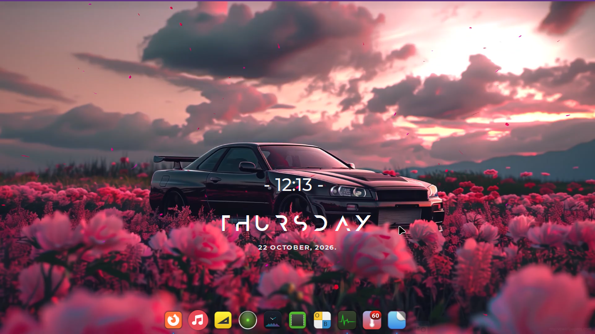
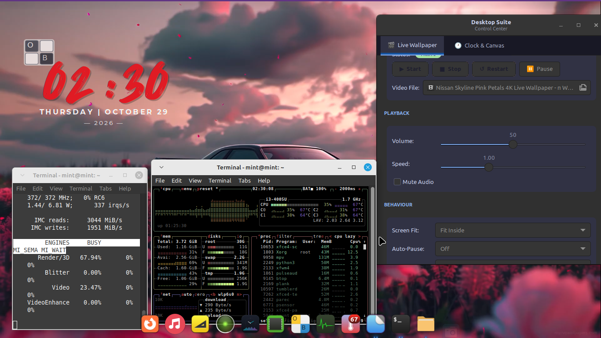
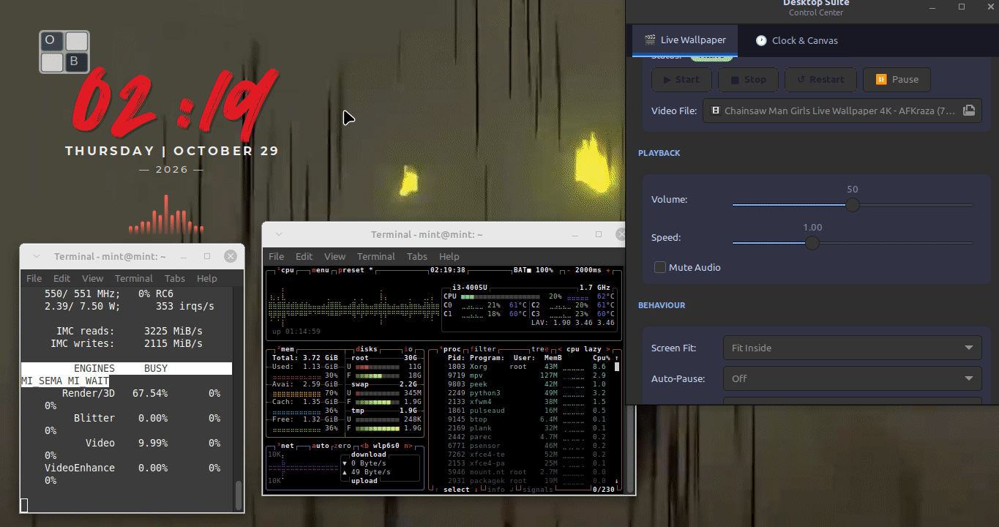
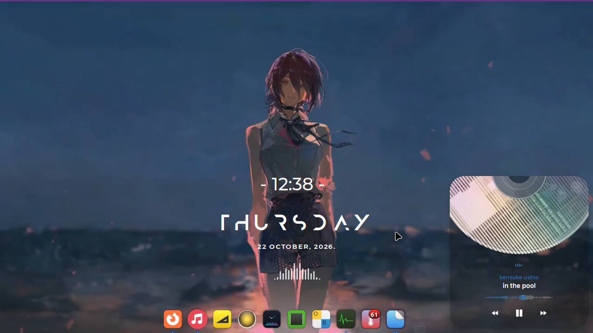
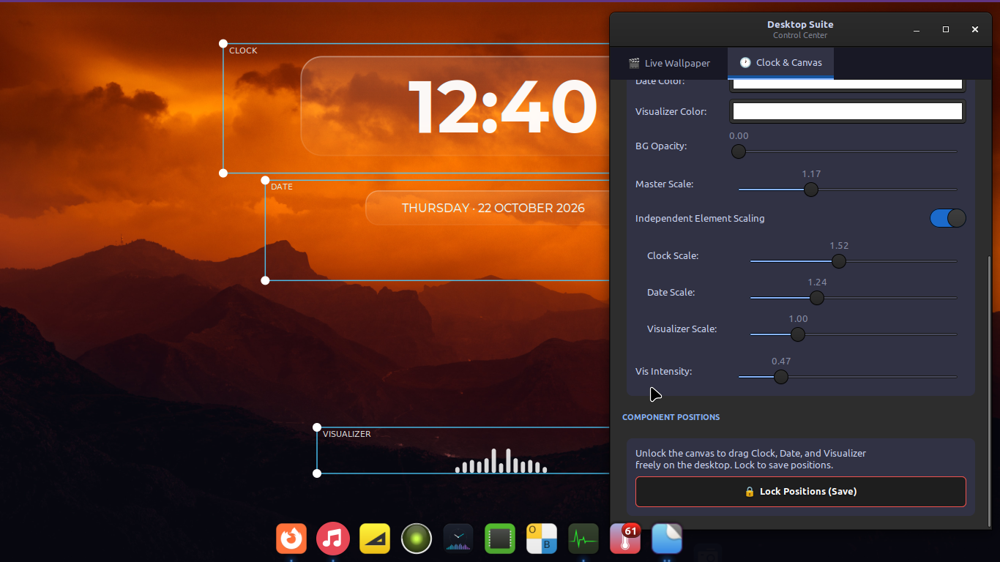
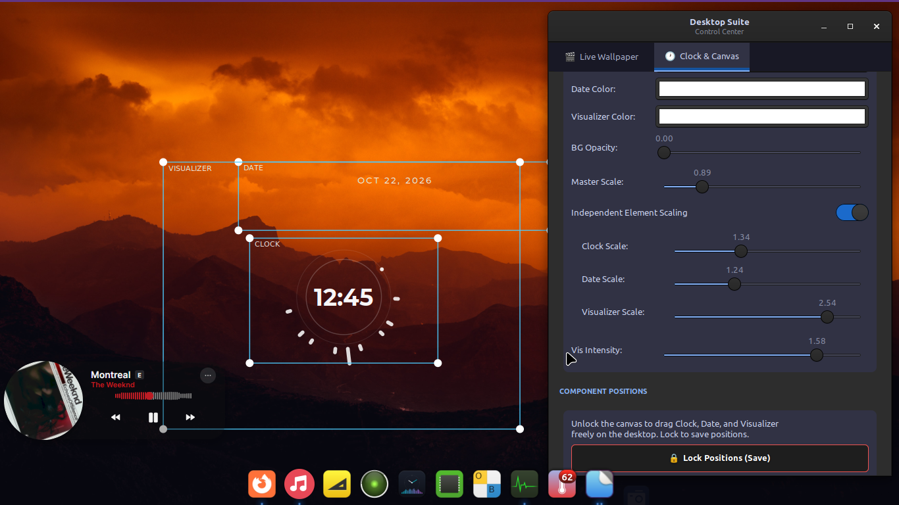
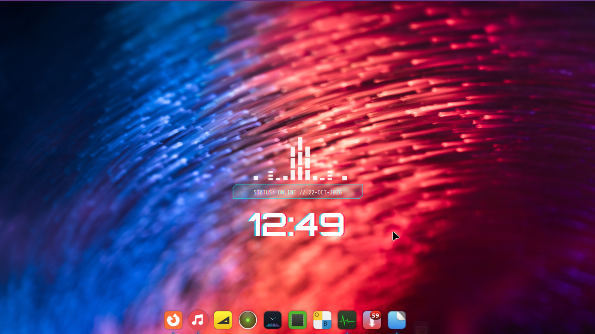
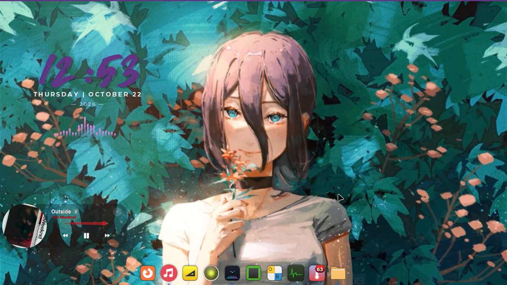

# DesktopSuite

[](LICENSE)
[](https://python.org)
[-orange.svg)]()
[]()

> **DesktopSuite** is an elegant, modular Desktop Widget & Live Wallpaper Engine for Linux. Featuring 26 iconic community-inspired Rainmeter themes, independent component drag-and-scale mechanics, decoupled RGB color customizers, real-time audio visualization, and a seamless video wallpaper engine.

---

<p align="center">
  
</p>

### 🎬 Live Desktop Showcase

<div align="center">
  <video src="assets/screenshots/00-hero-demo.mp4" width="100%" controls="controls" poster="assets/screenshots/01-hero-anurati-skyline.png">
    Your browser does not support the video tag. <a href="assets/screenshots/00-hero-demo.mp4">Click here to watch the demo clip</a>.
  </video>
</div>

<p align="center">
  <a href="assets/screenshots/00-hero-demo.mp4">▶ <strong>Watch Demo Clip (<code>00-hero-demo.mp4</code>)</strong></a>
</p>

> [!NOTE]
> **Recording Note:** The demo clip was recorded using Peek (~20 FPS) to maintain minimal capture overhead on low-resource hardware. Live desktop rendering runs at a native, fluid 60 FPS.

---

### 🖥️ Compatibility & Target Environment
* **Verified Distribution:** Linux Mint 21.3 ("Virginia") XFCE Edition (amd64)
* **Display Server:** X11 (`xwinwrap` and low-level Xlib window stacking require an active X11 session)
* **Window Manager / Desktop:** Xfwm4 / `xfdesktop`
* **Notice:** DesktopSuite has been developed and tested **exclusively on Linux Mint 21.3 XFCE under X11**. Support for Wayland sessions, alternate desktop environments (GNOME, KDE Plasma), or standalone tiling window managers (i3, bspwm, Hyprland) is currently untested and out of initial scope. Community testing and PRs are welcome.

---
## 🛠️ Core Features (By Studio Tab)

### 1. Live Wallpaper Engine
- **Engine Lifecycle Controls**: Full control with `Start`, `Stop`, `Restart`, and `Pause`/`Resume` actions, accompanied by live status monitoring.
- **Hardware-Accelerated Video Backdrops**: Native local video picker for MP4/H.264 files leveraging MPV and VA-API hardware decoding for negligible CPU usage.
- **Real-Time Playback Tuning**:
  - Live volume slider (0% to 100%).
  - Playback speed multiplier slider (0.25x to 2.0x).
  - Instant one-click `Mute Audio` toggle.
- **Window & Power Management**:
  - Screen Fit modes: `Fill (Zoom)`, `Fit (Letterbox)`, and `Stretch`.
  - Smart Auto-Pause triggers: Automatically pauses wallpaper playback when application windows are maximized or fullscreen to preserve GPU bandwidth.
  - FPS Limiter: Option to cap playback at 30 FPS, 24 FPS, or run at native video framerates.
- **Desktop & Keyboard Shortcuts**:
  - In-GUI XFCE keyboard shortcut manager to bind wallpaper toggling to any key combination (default `<Super>w`).
  - Native autostart on user login toggle.

### 2. Clock & Canvas HUD Studio
- **26 Community Master Themes**: Built-in typography and widget presets ranging from Swiss minimalism to retro 8-bit arcade and cyberpunk aesthetics.
- **Decoupled Component Hierarchy**:
  - Independent visibility toggles for Clock, Date, and Visualizer.
  - Decoupled Native RGB Color Pickers for Clock, Date, and Visualizer with instant live Cairo canvas redraw.
  - Background Opacity slider (0% transparent to 100% black).
- **Proportional & Independent Scaling**:
  - Master Canvas Scale slider (0.5x to 2.5x).
  - Independent Component Scaling switches with dedicated sliders for Clock Scale (0.4x to 3.0x), Date Scale (0.4x to 3.0x), and Visualizer Scale (0.4x to 3.0x).
  - Visualizer Intensity slider (10% to 200%) to scale spectrum bar amplitude dynamically.
- **Interactive Drag-and-Drop Canvas Layout**:
  - Unlockable Edit/Drag Mode displaying bounding boxes and corner anchor nodes.
  - Components can be repositioned independently anywhere across single or multi-monitor workspaces.
  - Atomic coordinate persistence flushed directly to `~/.config/desktop-suite/config.json`.

---

> [!IMPORTANT]
> **Desktop Icons & X11 Architecture Note:**
> Under the X11 windowing system and `xfdesktop`, the hardware-accelerated video stream (`xwinwrap` + `mpv`) sits immediately above the root desktop wallpaper window, visually covering static desktop file icons while video playback is active. All DesktopSuite clock, date, and visualizer widgets remain fully interactive and visible above the video stream. When live video playback is stopped, desktop icons are immediately uncovered and accessible.

---

## 📊 Performance & Real-World Benchmarks

### Testbed Specifications
- **CPU:** Intel Core i3-4005U (2C/4T @ 1.70 GHz, Haswell)
- **RAM:** 4 GB DDR3
- **Graphics:** Intel HD Graphics 4400 (VA-API enabled)
- **OS:** Linux Mint 21.3 ("Virginia") XFCE (amd64, X11)

### Real-Time Resource Footprint
| Component / Process | Resident Memory | CPU Usage | Role |
| :--- | :--- | :--- | :--- |
| **`mpv`** | ~131 MB | ~3.9% | Hardware-accelerated root window video decoding |
| **`python3`** | ~50 MB | ~2.5% | GTK3/Cairo vector canvas & PulseAudio FFT listener |
| **`xwinwrap`** | < 2 MB | ~0.0% | X11 root desktop embedding wrapper |
| **Total Suite** | **~197 MB** | **~4.0%** | **Full live wallpaper + canvas pipeline** |

### Hardware Telemetry Capture


* **Silicon Offloading:** Video decoding is offloaded entirely to the Intel HD 4400's fixed-function MFX/VDBOX engine via VA-API (`--hwdec=vaapi`), registering 23.47% Video engine load in `intel_gpu_top`.
* **Thermal & Power Efficiency:** The iGPU operates at its baseline idle frequency (372 MHz at 1.44 W package power), keeping the dual-core CPU free for lightweight 2D Cairo drawing and FFT audio math.

### Live Playback & Responsive Canvas


---

## 🎨 Theme & Studio Showcase

<p align="center">
  
  
</p>
<p align="center">
  
  
</p>
<p align="center">
  
</p>

---

## 📸 Master Theme Collection (26 Themes)

| Theme Name | Style Description | Primary Typography |
| :--- | :--- | :--- |
| **Mond Minimal** | Community favorite with tracked day, dashed time subtext, and baseline bars | Anurati & Montserrat |
| **Cyberpunk 2077** | Chromatic aberration cyan/magenta glow, chamfered status badge, and neon bars | Orbitron Bold |
| **FLHUD** | Sci-fi bracketed HUD digits `[ 04:20 ]`, dual-column subtext, flanked bars | Orbitron & Share Tech Mono |
| **Enigma Classic** | Classic HUD layout with LOCAL header, dotted date notation, precision bars | Share Tech Mono |
| **Pixel Arcade** | 8-bit retro gaming numerals with stepped LED matrix block visualizer | Press Start 2P |
| **Liquid Glass** | Translucent frosted glass card with linear specular border highlights | Montserrat Bold |
| **Circular Orbit** | Concentric circular dial with orbital second satellite and radial ray visualizer | Montserrat Bold |
| **Textime** | Phonetic word clock ("FOUR" / "TWENTY") with micro tracked date | Montserrat Bold & Light |
| **Braun Dieter** | Mid-century German functionalism with signature safety-orange separator dot | Montserrat Bold |
| **Nordic Glint** | Refined classical roman serif layout with diamond glyph separators (`◇`) | Cinzel |
| **Matrix CLI** | Monospace green phosphor terminal prompt `[user@mint ~]$` with ASCII meter | Share Tech Mono |
| **Zen Garden** | Serene circular proportions flanked by pebble rings and water ripple waves | Comfortaa |
| **Vector Tactical** | Military HUD stencil digits flanked by crosshairs and targeting reticles | Orbitron |
| **Elegance Two-Tone** | Ultra-tall hairline condensed numerals with decoupled hour/minute weights | Bebas Neue |
| **Elegance 2** | Hairline ultra-thin geometric numerals with extra-wide tracked subtext | Montserrat Light |
| **Lumiero Capsule** | Clean numerals with frosted rounded pill date badge and symmetrical bars | Bebas Neue & Montserrat |
| **Lines 2.0** | Numerals with twin baseline rules extending across screen and hairline bars | Montserrat Bold |
| **Dot Matrix LED** | Digital vacuum fluorescent VFD style with fading dot matrix columns | VT323 |
| **Astro Editorial** | Poster-scale stacked numerals with vertical day text and solid wave visualizer | Bebas Neue |
| **Neumorph Soft** | Soft UI embossed dual light/shadow styling with recessed pill container | Montserrat Bold |
| **Sonder Axis** | Vertical Japanese accent spine with Shojumaru day header and dual-direction bars | Shojumaru & Montserrat |
| **Wild Youth** | Expressive authentic handwriting with soft drop shadow and gradient bars | Caveat & Wild Youth |
| **Chrono Block** | Condensed numerals with square colon blocks and LED visualizer | Bebas Neue & SF Sports Night |
| **Vertical Overlap**| Massive architectural numbers tightly stacked with watermark day | Anton |
| **Mond Clean** | Minimalist clean white-on-transparent reference clock | Montserrat Bold |
| **Original Cursive**| Flowing calligraphic cursive script with smooth baseline visualizer | Caveat |

---

## 🚀 Quick Start & Installation

### 1. Prerequisites (Ubuntu / Debian / Linux Mint)
```bash
sudo apt update
sudo apt install -y python3 python3-pip python3-gi python3-gi-cairo \
                    gir1.2-gtk-3.0 mpv libfontconfig1 fontconfig
```

### 2. Install DesktopSuite
Clone the repository and run the native installer:
```bash
git clone https://github.com/majordark8139/DesktopSuite.git
cd DesktopSuite
./install.sh
```

The installer will:
1. Create the executable launcher at `~/.local/bin/desktop-suite`.
2. Install bundled fonts to `~/.local/share/fonts/desktop-suite/` and refresh Fontconfig.
3. Install the application icon to `~/.local/share/icons/hicolor/256x256/apps/desktop-suite.png`.
4. Register the desktop application menu entry `desktop-suite.desktop`.

---

## 🎮 Usage

### GUI Control Center
Launch from your application menu or run from terminal:
```bash
desktop-suite
```

### Command-Line Interface (CLI)
DesktopSuite includes lightweight CLI control flags for keybindings and scripts:
```bash
desktop-suite                      # Launch full GTK3 Settings GUI & Engine
desktop-suite --daemon             # Launch background widget canvas & audio service
desktop-suite --toggle-wallpaper   # Toggle live video wallpaper on/off instantly
desktop-suite --kill-wallpaper     # Terminate any running live wallpaper process
desktop-suite --version            # Print version information
```

---

## 🧪 Testing

Run the automated headless Cairo verification suite:
```bash
python3 -m unittest discover tests
```

---

## 🗑️ Uninstallation

To cleanly remove DesktopSuite integration from your user environment:
```bash
./uninstall.sh
```
*(Your git repository and configuration files remain untouched)*

---

## 🤖 Development & Acknowledgements

DesktopSuite was designed and built with assistance from LLMs (Claude & Gemini) for rapid Cairo geometry prototyping, mathematical layout calibration, and scaffolding. All components have been manually tested, debugged, and benchmarked on physical hardware to ensure strict performance and memory limits.

Special thanks to the community creators of Rainmeter skins (Mond, Enigma, FLHUD, Lines 2.0, Wild Youth, Chrono Block) whose artistic layouts inspired the open-source typography and rendering implementations in DesktopSuite.

---

## 📄 License

MIT License. See [LICENSE](LICENSE) for details.
